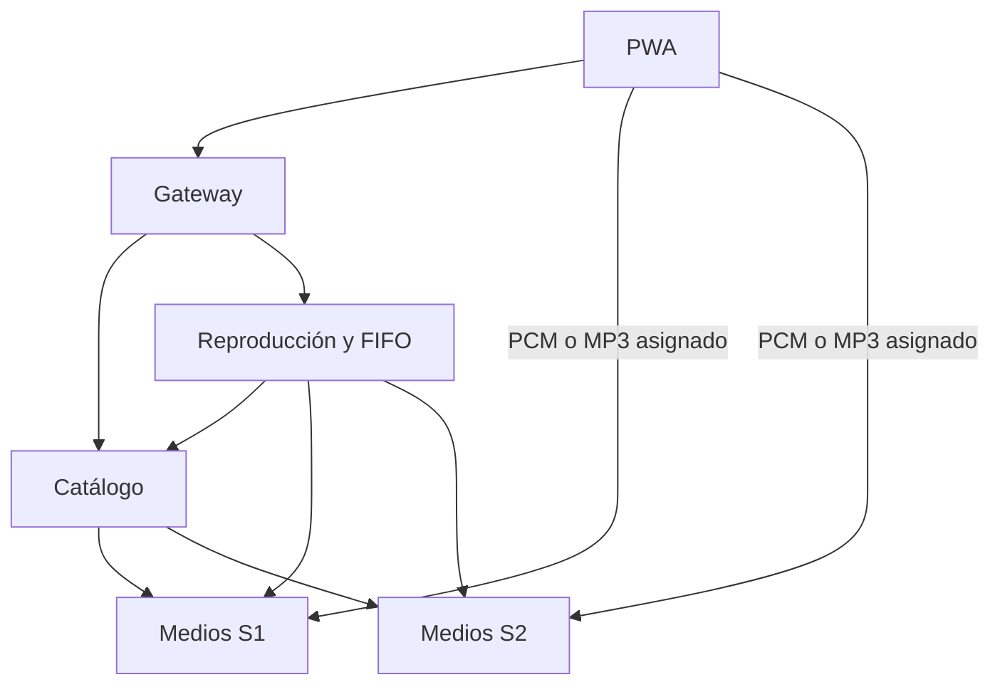

# P08: aplicaciones con microservicios

Base: `main` de P07, commit `86005c2bf7c1fe232c13bc1535b8a3a6ab0605ae`.
Rama de trabajo: `feature/microservices-p08`.

## Límites y responsabilidades

Hay cuatro tipos de servicio y cinco procesos. S1 y S2 son dos instancias del servicio de medios con bibliotecas distintas.

| Servicio | Estado propio | Responsabilidad | Puerto local |
|---|---|---|---|
| Gateway | Sin estado de negocio | Entrada pública de control, CORS y propagación de identificadores de solicitud | 8000 |
| Catálogo | Caché de metadatos en memoria | Consulta de nodos, deduplicación SHA-256 y disponibilidad | 8001 |
| Reproducción | SQLite privada: tickets y FIFO | Asignación por recursos, espera, cancelación y vencimiento | 8002 |
| Medios S1 | Sus archivos y sesiones en memoria | Reserva, métricas, PCM y copias MP3 | 5000 |
| Medios S2 | Sus archivos y sesiones en memoria | Misma capacidad, biblioteca propia | 5001 |



Cada aplicación Flask tiene su propio proceso, configuración, contenedor y ciclo de vida. No se instancia `SoundFlowServer` en P08. El código compartido se limita a transporte, validación y utilidades de audio; ningún servicio abre la base de otro ni lee sus diccionarios Python. El catálogo y el coordinador acceden a medios por HTTP.

El gateway maneja el plano de control. Tras una asignación, el navegador recibe bytes directamente del nodo de medios para evitar retransmitir PCM por los servicios de control. No se trata de cinco microservicios distintos de negocio: hay cuatro capacidades y dos réplicas de medios con contenido diferente.

## Flujo y contratos

1. PWA → gateway `GET /api/catalog` → catálogo → medios `/internal/v1/node`.
2. El catálogo deduplica canciones y el gateway añade `entrypoints`, con direcciones de gateway. El cliente no aprende medios como si fueran coordinadores.
3. PWA → gateway `POST /api/requests` → reproducción. Se responde `202`; la FIFO se atiende en un hilo del servicio, sin bloquear el POST durante las llamadas entre servicios.
4. Reproducción consulta `/internal/v1/nodes` y ordena los portadores por sesiones, CPU y memoria. Reserva mediante `POST /internal/v1/streams`.
5. La reserva incluye `reservation_id`: repetir la misma operación en el mismo nodo devuelve la misma sesión reservada y no duplica el consumo.
6. La PWA consulta el ticket y recibe la URL pública del medio. Recibe PCM desde `/api/streams/<id>/audio`, o MP3 desde `/api/streams/<id>/download` para guardar recientes.
7. `DELETE /api/requests/<id>` cancela por el gateway y reproducción libera la sesión remota. La cancelación contempla que una asignación finalice mientras llega DELETE.

La API pública mantiene los campos de P07 y añade `Catalog.entrypoints`. Las rutas internas se versionan bajo `/internal/v1/` y requieren `X-Cluster-Token`. El token nunca se publica en `VITE_*`. Cada llamada propaga `X-Request-ID`; las respuestas y logs identifican el servicio y su versión. `GET /api/services` en el gateway comprueba catálogo y reproducción, sin divulgar sus direcciones internas.

## Qué se conserva

- PWA, manifiesto, service worker con actualizaciones solicitadas y caché versionada de la interfaz.
- AudioWorklet y PCM S16LE estéreo, 44.1 kHz; recorte por muestra para reanudar MP3 sin duplicados.
- Reproducción desde catálogo, búsqueda, selección, cola opcional, pausa, volumen y avance.
- Hasta tres MP3 recientes completos en IndexedDB, máximo 24 MiB por copia, validación SHA-256 y reemplazo transaccional de la menos utilizada.
- Las 18 canciones y los manifiestos: 12 por nodo, seis compartidas. Se agregan canciones editando los manifiestos, sin fijar cantidades en la aplicación.
- Sin contador máximo de clientes. La admisión depende de recursos físicos y la espera es finita y cancelable.

La FIFO de solicitudes ahora pertenece al servicio de reproducción, no a cada medio. La cola de canciones de la interfaz sigue siendo independiente.

## Inicio local, sin Docker

Detén los servidores P07 y el frontend previo. Desde la raíz:

```bash
source .venv/bin/activate
python -m pip install -r requirements-dev.txt
python tools/run_microservices.py
```

El lanzador prepara las bibliotecas e inicia cinco procesos con un token temporal compartido, sin mostrarlo. Ctrl+C los detiene. Los puertos ocupados producen un error explícito. Los logs permanecen en terminal.

En otra terminal, desde la raíz:

```bash
cd frontend
npm ci
npm run dev
```

Abre `http://localhost:5173`. El acceso predeterminado de desarrollo es **solo** `http://127.0.0.1:8000`. Desde la configuración de la aplicación se introduce el gateway, no S1/S2. La P08 utiliza una clave nueva para esta configuración; conserva las copias IndexedDB existentes en el mismo origen/base y actualiza la biblioteca después de una consulta conectada.

Para probar instalación y desconexión:

```bash
cd frontend
VITE_API_URLS="http://127.0.0.1:8000" VITE_BASE_PATH="/SoundFlow/" npm run build
npm run preview:pwa
```

Abre `http://localhost:5173/SoundFlow/`. Detén `npm run dev` antes de preview porque comparten puerto. Si aparece una versión pendiente, acepta **Actualizar ahora**. Mantén una primera visita conectada hasta preparar el worker. Comprueba las copias dentro del navegador o app instalada que vayas a usar; Safari puede separar sus almacenes.

## Docker Compose

Requiere Docker con Compose. Copia `deploy/p08.env.example` a `.env` en la raíz y sustituye su valor por uno generado localmente:

```bash
python -c "import secrets; print(secrets.token_urlsafe(32))"
docker compose config --quiet
docker compose up --build -d
docker compose ps
docker compose logs -f gateway catalog playback
```

Las URL de servicio de Compose usan DNS interno (`media-s1`, `catalog`, etc.). Las URL anunciadas al navegador usan `127.0.0.1`. Solo se publican gateway y medios en el host; catálogo y reproducción quedan en la red de Compose. El volumen `playback-state` conserva SQLite entre reinicios. Detén con `docker compose down`; no uses `-v` si quieres conservar ese estado.

Para volver a ejecutar el lanzador sin Docker, detén primero Compose porque los puertos coinciden. El frontend se compila y prueba igual en ambas variantes.

## Pruebas

```bash
python -m pytest -q
cd frontend
npm test
npm run build
cd ..
python tools/check_microservices.py
cd frontend
npx playwright install chromium
npm run test:pwa
```

- `test_microservices.py` levanta cinco aplicaciones HTTP aisladas: límites, autenticación interna, catálogo, FIFO, doce sesiones, cancelación, idempotencia, descarga íntegra, caída del catálogo y del nodo, persistencia privada y entradas inválidas.
- `check_microservices.py` inicia cinco **procesos Gunicorn** y prueba el cliente TypeScript con los manifiestos y MP3 reales, incluyendo reanudación exacta y descarga para IndexedDB.
- Playwright prueba la compilación con un fixture HTTP controlado: manifiesto, offline, exclusión de API de la caché, actualizaciones, vista móvil, copias completas, pausa/avance, límite tres y descarga truncada. Este fixture no sustituye la integración real anterior.
- Checks ejecuta pruebas y compilación; construye las cinco imágenes. No se requiere instalar Docker para usar el lanzador local.

La salida de audio física y la instalación desde el menú del sistema se comprueban manualmente.

## Pruebas de fallos para la demostración

Con Compose se puede detener y reiniciar una capacidad de manera independiente:

```bash
docker compose stop media-s2
# Actualiza biblioteca: S2 debe estar caído. Una compartida puede asignarse a S1.
docker compose start media-s2
docker compose stop catalog
# Un audio ya asignado sigue siendo recibido del medio; nuevas consultas fallan con 503.
docker compose start catalog
```

Tras recuperar el servicio, actualiza la biblioteca. No se garantiza que una canción exclusiva siga por red si su único nodo cae; puede reproducirse si existe su copia local. Una caída del gateway o reproducción impide nuevas asignaciones, pero no corta por sí misma una transferencia directa ya abierta.

## Estado y límites operativos

SQLite es privada de reproducción. Un reinicio del **proceso** con el mismo archivo recupera tickets y orden FIFO; no garantiza recuperar bytes o sesiones de un medio reiniciado. En Render Free el disco es efímero: un redeploy/reinicio puede perder la cola. Persistencia duradera en nube requiere un disco o una base externa exclusiva del servicio.

Esta entrega usa una instancia de reproducción y un worker Gunicorn por servicio. No proporciona alta disponibilidad ni escalado horizontal de SQLite o de sesiones. Los medios se pueden añadir como instancias independientes con identificadores distintos, bibliotecas propias y el registro actualizado tanto en catálogo como en reproducción. No se afirma escalabilidad ilimitada.

La caché de metadatos del catálogo y las sesiones de medios son locales a cada servicio; no se comparten entre procesos. Reservas sin consumir vencen a los 30 segundos y los tickets pendientes a los 120 segundos por defecto. Los tickets terminales se limpian una hora después de crearse. Las llamadas HTTP tienen timeout; no se reintentan operaciones indiscriminadamente.

Los módulos P06/P07 y el `Dockerfile`/`render.yaml` de raíz se conservan como compatibilidad y regresión. No forman parte del arranque P08 ni se montan dentro de sus imágenes. Esto permite validar P08 sin cambiar los servicios públicos que ya funcionan. Para publicar P08 usa [DEPLOYMENT_P08.md](DEPLOYMENT_P08.md).

Referencias: [Microsoft: arquitectura de microservicios](https://learn.microsoft.com/en-us/azure/architecture/guide/architecture-styles/microservices), [Docker Compose: orden y salud](https://docs.docker.com/compose/how-tos/startup-order/), [Render: límites de Free](https://render.com/docs/free).
